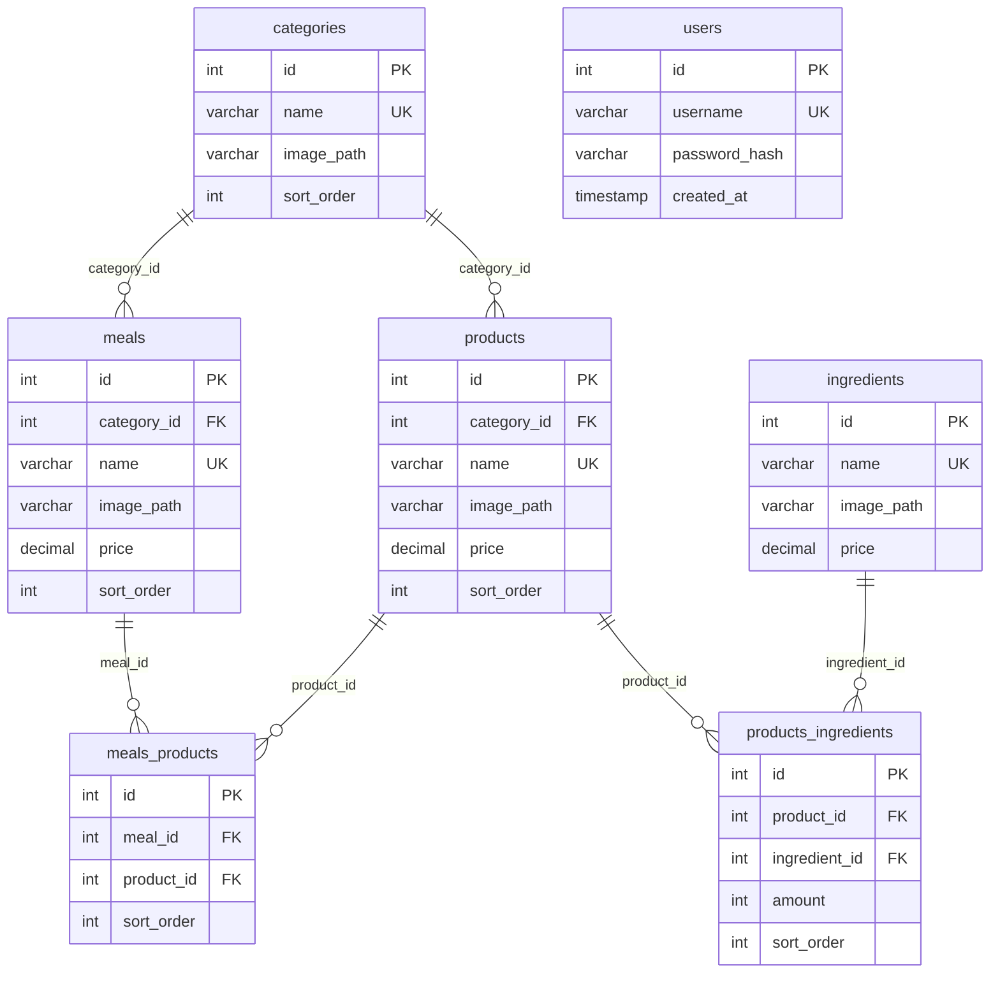

# express-kiosk-api

REST API for a self-service fast-food ordering kiosk, built with **Express 5** and **MySQL**.

The API serves a McDonald's-style menu tree — categories → meals → products → ingredients — plus the
joined "what is inside this meal / this burger" views a kiosk screen needs, static menu artwork, and a
JWT-protected admin surface for editing the menu and resetting the database.

---

## Table of contents

- [Features](#features)
- [Tech stack](#tech-stack)
- [Project structure](#project-structure)
- [Prerequisites](#prerequisites)
- [Getting started](#getting-started)
  - [1. Environment variables](#1-environment-variables)
  - [2. Run locally](#2-run-locally)
  - [3. Run with Docker](#3-run-with-docker)
- [Database bootstrap & seeding](#database-bootstrap--seeding)
- [Authentication](#authentication)
- [API reference](#api-reference)
  - [Docs](#docs)
  - [Auth](#auth)
  - [Users](#users)
  - [Tables (admin)](#tables-admin)
  - [Menu resources](#menu-resources)
  - [Composite reads](#composite-reads)
  - [Images](#images)
- [Rate limiting](#rate-limiting)
- [Response conventions](#response-conventions)
- [Data model](#data-model)
- [Notes & known limitations](#notes--known-limitations)
- [License](#license)

---

## Features

- **Menu catalogue** — CRUD-style endpoints for categories, meals, products, ingredients and their two
  join tables (`meals_products`, `products_ingredients`).
- **Composite reads** — `GET /selected_meal/:id` and `GET /selected_product/:id` return a single
  denormalized payload (meal with its products, product with its ingredients and amounts), ordered by
  `sort_order`, ready to render on a kiosk screen.
- **Image serving** — `GET /images/...` streams the bundled PNG artwork from `assets/`.
- **Auth** — registration gated behind a shared `x-register-key` header, login issuing a JWT that
  expires after 30 minutes; bcrypt password hashing (10 salt rounds).
- **Hardening** — `helmet` security headers, tiered `express-rate-limit` limiters, `trust proxy` set
  for correct client IPs behind one reverse proxy.
- **Self-initializing schema** — tables are created on boot; a single admin call reseeds the whole menu
  with the bundled demo data.
- **Self-documenting** — `GET /` returns a JSON map of the available endpoints.

## Tech stack

| Concern        | Package                                    |
| -------------- | ------------------------------------------ |
| HTTP framework | [`express`](https://expressjs.com/) `^5.2.1` |
| Database       | [`mysql2`](https://github.com/sidorares/node-mysql2) `^3.22.5` (promise pool) |
| Passwords      | `bcrypt` `^6.0.0`                          |
| Tokens         | `jsonwebtoken` `^9.0.3`                    |
| Headers        | `helmet` `^8.2.0`                          |
| Rate limiting  | `express-rate-limit` `^8.5.2`              |
| CORS           | `cors` `^2.8.6`                            |
| Config         | `dotenv` `^17.4.2`                         |
| Dev reload     | `nodemon` `^3.1.14`                        |
| Runtime        | Node.js 22 (`node:22-alpine` in Docker)    |

## Project structure

```
express-kiosk-api/
├── index.js                  # App entry: middleware wiring, route mounting, listen()
├── config.js                 # Centralized process.env access
├── db/
│   └── db.js                 # mysql2 connection pool + initDB() (creates all tables)
├── middleware/
│   ├── checkJWT.js           # Bearer token verification -> req.user
│   ├── checkRegisterKey.js   # x-register-key header gate for /auth/register
│   └── rateLimiters.js       # default (250), calm (500), strict (25) per 5 min
├── routes/                   # One router per resource (HTTP verbs + middleware)
├── controllers/              # Request handlers: SQL, validation, status codes
├── models/                   # Per-table DDL (createXTable) + demo seed data (createXData)
├── assets/
│   ├── categories/  (8 PNG)
│   ├── ingredients/ (32 PNG)
│   ├── meals/       (10 PNG)
│   └── products/    (28 PNG)
├── dockerfile
├── docker-compose.yml
└── package.json
```

The layering is strictly `routes → controllers → db pool`, with `models/` holding only schema DDL and
seed SQL (no ORM).

## Prerequisites

- **Node.js 22+** and npm (or Docker + Docker Compose)
- **MySQL 8+** server reachable from the app, with a database already created for it
  (`CREATE DATABASE <DB_NAME>;`). The app creates its own *tables* but not the *database*.

## Getting started

### 1. Environment variables

All configuration is read from the environment via `config.js`. Create a `.env` file in the project
root (it is git-ignored):

```dotenv
# Server
PORT=3000
NODE_ENV=development

# MySQL
DB_HOST=localhost
DB_PORT=3306
DB_USERNAME=root
DB_PASSWORD=your_password
DB_NAME=kiosk

# Security
JWT_SECRET=a_long_random_string
REGISTER_KEY=another_long_random_string
```

| Variable        | Required | Description                                                              |
| --------------- | -------- | ------------------------------------------------------------------------ |
| `PORT`          | yes      | Port the HTTP server listens on.                                          |
| `NODE_ENV`      | no       | Environment name (currently only referenced by the commented-out CORS policy). |
| `DB_HOST`       | yes      | MySQL host.                                                               |
| `DB_PORT`       | yes      | MySQL port (typically `3306`).                                            |
| `DB_USERNAME`   | yes      | MySQL user.                                                               |
| `DB_PASSWORD`   | yes      | MySQL password.                                                           |
| `DB_NAME`       | yes      | Database name; must already exist.                                        |
| `JWT_SECRET`    | yes      | HMAC secret used to sign and verify login tokens.                         |
| `REGISTER_KEY`  | yes      | Shared secret required in the `x-register-key` header to create users.    |

> If the pool cannot reach MySQL, `initDB()` logs the error and calls `process.exit(1)`.

### 2. Run locally

```bash
git clone https://github.com/shrexss/express-kiosk-api.git
cd express-kiosk-api
touch .env             # then fill it in as shown above (no .env.example is committed)
npm install

npm run dev            # nodemon with live reload (-L, Docker/volume-safe)
# or
npm start              # plain node index.js
```

On success the console prints `working on port <PORT>`. Verify with:

```bash
curl http://localhost:3000/          # endpoint documentation JSON
```

There is no test suite yet — `npm test` exits with an error by design.

### 3. Run with Docker

The compose file builds the API image and mounts the source for hot reload. It runs the **API only**;
MySQL is expected to be provided separately (locally, in another container, or managed).

```bash
docker compose up --build
```

`docker-compose.yml` runs `npm run dev` inside the container, publishes `${PORT}:${PORT}` and loads
variables from `.env` (Compose also uses `.env` for its own `${PORT}` interpolation). The bundled
`dockerfile` (`node:22-alpine`) exposes `3000`, but the effective port always comes from `PORT`.

To point the containerized API at a MySQL running on the host, use `DB_HOST=host.docker.internal`
(Linux: add `extra_hosts: ["host.docker.internal:host-gateway"]` to the service).

## Database bootstrap & seeding

Two distinct things happen, and they are easy to confuse:

1. **On every boot** — `db/db.js` calls `initDB()`, which runs `CREATE TABLE IF NOT EXISTS` for
   `users`, `categories`, `meals`, `products`, `ingredients`, `meals_products` and
   `products_ingredients`. **Structure only — no rows are inserted.**
2. **On demand** — `POST /tables/reset_DB` (JWT required) drops and recreates the six menu tables
   inside a transaction and inserts the bundled demo data:

   | Table                  | Seeded rows |
   | ---------------------- | ----------- |
   | `categories`           | 8           |
   | `meals`                | 10          |
   | `products`             | 28          |
   | `ingredients`          | 32          |
   | `meals_products`       | 30          |
   | `products_ingredients` | 56          |

   The `users` table is **not** touched by the reset.

So a fresh install needs one seeding call before the menu endpoints return anything:

```bash
# 1) register an admin user (needs REGISTER_KEY)
curl -X POST http://localhost:3000/auth/register \
  -H "Content-Type: application/json" \
  -H "x-register-key: $REGISTER_KEY" \
  -d '{"username":"admin","password":"s3cret"}'

# 2) log in and keep the token
TOKEN=$(curl -s -X POST http://localhost:3000/auth/login \
  -H "Content-Type: application/json" \
  -d '{"username":"admin","password":"s3cret"}' | grep -o '"token":"[^"]*' | cut -d'"' -f4)

# 3) create + seed the menu tables
curl -X POST http://localhost:3000/tables/reset_DB \
  -H "Authorization: Bearer $TOKEN"
```

> ⚠️ `reset_DB` is destructive: it `DROP`s the menu tables (foreign key checks temporarily disabled)
> and restores the demo menu. Never run it against a database holding real data.

## Authentication

Two credentials protect the API:

| Mechanism         | Where                              | How to send                                       |
| ----------------- | ---------------------------------- | ------------------------------------------------- |
| **Register key**  | `POST /auth/register` only         | `x-register-key: <REGISTER_KEY>` header            |
| **JWT**           | All routes marked 🔒 below         | `Authorization: Bearer <token>` header             |

`POST /auth/login` returns a token whose payload is `{ userId, username }` and which **expires after
30 minutes**; re-login to get a new one.

```json
{
  "success": true,
  "token": "eyJhbGciOiJIUzI1NiIsInR5cCI6IkpXVCJ9...",
  "user": { "id": 1, "username": "admin" }
}
```

Auth-related failures:

| Status | Cause                                                        |
| ------ | ------------------------------------------------------------ |
| `400`  | `username` or `password` missing from the body                |
| `401`  | Unknown username / wrong password / no `Authorization` header / no `x-register-key` |
| `403`  | Token invalid or expired / register key does not match        |
| `409`  | Username already taken (duplicate on register)                |

## API reference

Base URL: `http://localhost:3000` (or your configured `PORT`). 🔒 = requires a valid JWT.

### Docs

| Method | Path | Auth | Description |
| ------ | ---- | ---- | ----------- |
| `GET`  | `/`  | —    | JSON documentation listing the endpoints and whether they need a JWT. |

### Auth

| Method | Path              | Auth              | Description |
| ------ | ----------------- | ----------------- | ----------- |
| `POST` | `/auth/register`  | `x-register-key`  | Create a user. Body: `{ "username", "password" }` → `201`. |
| `POST` | `/auth/login`     | —                 | Log in. Body: `{ "username", "password" }` → `{ success, token, user }`. |

### Users

| Method   | Path          | Auth | Description |
| -------- | ------------- | ---- | ----------- |
| `GET`    | `/users`      | 🔒   | All users (`id`, `username`, `created_at`; hashes are never selected). |
| `GET`    | `/users/:id`  | 🔒   | One user. |
| `PATCH`  | `/users/:id`  | 🔒   | Update any supplied columns. |
| `DELETE` | `/users/:id`  | 🔒   | Delete a user. |

### Tables (admin)

| Method | Path                 | Auth | Description |
| ------ | -------------------- | ---- | ----------- |
| `GET`  | `/tables`            | 🔒   | Every table in the database with its column names (`SHOW TABLES` / `SHOW COLUMNS`). |
| `POST` | `/tables/reset_DB`   | 🔒   | Drop, recreate and reseed the menu tables. **Destructive.** |

### Menu resources

`categories`, `meals`, `products`, `ingredients`, `meals_products` and `products_ingredients` all
share the same shape — reads are public, writes are protected:

| Method   | Path                     | Auth | Description |
| -------- | ------------------------ | ---- | ----------- |
| `GET`    | `/{resource}`            | —    | All rows. |
| `GET`    | `/{resource}/:id`        | —    | One row. |
| `PATCH`  | `/{resource}/:id`        | 🔒   | Generic update: each key in the JSON body becomes a `SET column = ?`. |
| `DELETE` | `/{resource}/:id`        | 🔒   | Delete one row. |

where `{resource}` ∈ `categories`, `meals`, `products`, `ingredients`, `meals_products`,
`products_ingredients`.

```bash
# public read
curl http://localhost:3000/categories

# protected update
curl -X PATCH http://localhost:3000/products/1 \
  -H "Authorization: Bearer $TOKEN" \
  -H "Content-Type: application/json" \
  -d '{"price": 6.49, "sort_order": 5}'
```

### Composite reads

| Method | Path                     | Auth | Description |
| ------ | ------------------------ | ---- | ----------- |
| `GET`  | `/selected_meal/:id`     | —    | Meal joined with its products, ordered by `meals_products.sort_order`. |
| `GET`  | `/selected_product/:id`  | —    | Product joined with its ingredients (incl. `amount` and unit `price`), ordered by `products_ingredients.sort_order`. |

`GET /selected_meal/1`

```json
{
  "id": 1,
  "name": "Big Mac Extra Value Meal",
  "image_path": "/assets/meals/meal_big_mac.png",
  "price": "9.89",
  "products": [
    { "id": 1,  "name": "Big Mac",                     "image_path": "/assets/products/big_mac.png", "sort_order": 10 },
    { "id": 15, "name": "Medium World Famous Fries",   "image_path": "/assets/products/fries_m.png", "sort_order": 20 },
    { "id": 18, "name": "Coca-Cola Classic (Medium)",  "image_path": "/assets/products/coke_m.png",  "sort_order": 30 }
  ]
}
```

`GET /selected_product/1`

```json
{
  "id": 1,
  "name": "Big Mac",
  "image_path": "/assets/products/big_mac.png",
  "price": "5.99",
  "ingredients": [
    { "id": 9,  "name": "Big Mac Club Bun (3-Part)",    "image_path": "/assets/ingredients/bun_big_mac.png",     "price": "0.70", "amount": 1, "sort_order": 10 },
    { "id": 1,  "name": "100% Beef Patty (1/10 lb)",    "image_path": "/assets/ingredients/beef_patty_small.png","price": "1.50", "amount": 2, "sort_order": 20 },
    { "id": 13, "name": "American Cheese Slice",        "image_path": "/assets/ingredients/cheese.png",          "price": "0.60", "amount": 1, "sort_order": 30 },
    { "id": 15, "name": "Shredded Lettuce",             "image_path": "/assets/ingredients/lettuce.png",         "price": "0.30", "amount": 1, "sort_order": 40 },
    { "id": 17, "name": "Pickle Slices",                "image_path": "/assets/ingredients/pickles.png",         "price": "0.25", "amount": 2, "sort_order": 50 },
    { "id": 19, "name": "Rehydrated Diced Onions",      "image_path": "/assets/ingredients/diced_onions.png",    "price": "0.20", "amount": 1, "sort_order": 60 },
    { "id": 20, "name": "Big Mac Sauce",                "image_path": "/assets/ingredients/big_mac_sauce.png",   "price": "0.50", "amount": 2, "sort_order": 70 }
  ]
}
```

### Images

| Method | Path                        | Auth | Description |
| ------ | --------------------------- | ---- | ----------- |
| `GET`  | `/images/{a}/{b}/{file}`    | —    | Streams a file from disk and returns `404` if it is missing. |

The handler joins **exactly three** path segments onto the project root, so menu artwork is fetched by
prefixing the stored `image_path` with `/images`:

```
image_path from the DB:  /assets/products/big_mac.png
URL to request:          /images/assets/products/big_mac.png
```

```bash
curl -O http://localhost:3000/images/assets/products/big_mac.png
```

Paths with fewer or more than three segments will not resolve.

## Rate limiting

`express-rate-limit` counters are in-memory (per process) and windowed at **5 minutes**. Because
`app.set('trust proxy', 1)` is enabled, the client IP is taken from `X-Forwarded-For` when running
behind one reverse proxy.

| Limiter          | Limit / 5 min | Applied to                                   |
| ---------------- | ------------- | -------------------------------------------- |
| `defaultLimiter` | 250           | Globally, every route                        |
| `calmLimiter`    | 500           | `/` (docs) and `/images`                     |
| `strictLimiter`  | 25            | `/auth` (register + login)                   |

Exceeding a limit returns `429`:

```json
{ "status": 429, "error": "Too many requests!" }
```

> The limiters stack: since the global 250-request limiter runs first, the 500-request `calmLimiter`
> never becomes the binding constraint in practice.

## Response conventions

- Success bodies are either the row(s) themselves, or `{ "message": "..." }` for mutations.
- Errors are `{ "error": "..." }` — except the missing-token case in `checkJWT`, which returns the bare
  JSON string `"Access denied"`.
- `PATCH` with an empty body returns `400 { "error": "No fields provided" }`.
- `PATCH` / `DELETE` on a non-existent id return `404`; `affectedRows === 0` is treated as "not found".
- Unhandled database failures return `500 { "error": "Internal server error" }`.
- `mysql2` returns `DECIMAL` columns as **strings** (e.g. `"price": "5.99"`); parse them client-side.

Common status codes: `200` ok · `201` created · `400` bad request · `401` unauthenticated ·
`403` forbidden · `404` not found · `409` conflict · `429` rate limited · `500` server error.

## Data model



A **meal** is a priced bundle of **products** (burger + fries + drink); a **product** is composed of
**ingredients** with an `amount` each, which is what lets the kiosk render a build-your-burger view.
`sort_order` controls display order everywhere; `image_path` values point at files under `assets/`
and are served through `/images`.

## Notes & known limitations

- **`GET /` overstates the API.** The built-in docs list `POST` create endpoints for `categories`,
  `meals`, `products`, `ingredients`, `meals_products` and `products_ingredients`, but no `POST`
  routes or create handlers are wired up for them. Rows are created by the seeder (`POST
  /tables/reset_DB`) or edited via `PATCH`. Trust this README over `/`.
- **CORS is currently wide open.** `app.use(cors())` accepts every origin; the stricter allowlist
  (which permits `http://localhost:5050`, the expected kiosk frontend) is present but commented out in
  `index.js`. Re-enable it before exposing the API publicly.
- **`PATCH` column names are not allow-listed.** Body keys are interpolated as column names in the
  `SET` clause (values are parameterized). On `/users/:id` that means a caller could write
  `password_hash` directly with an unhashed value. Restrict the accepted fields before production use.
- **No `POST /auth/*` rate-limit distinction** beyond `strictLimiter`, and no lockout or refresh-token
  flow — tokens simply expire after 30 minutes.
- **No tests, no linter, no CI.** `npm test` is the default npm placeholder.
- **No `db` service in `docker-compose.yml`** — bring your own MySQL, and make sure `DB_HOST` is
  reachable from the container.
- Seed data uses fixed explicit `id` values, so reseeding assumes the tables were dropped first.

## License

ISC — see [`package.json`](package.json).
